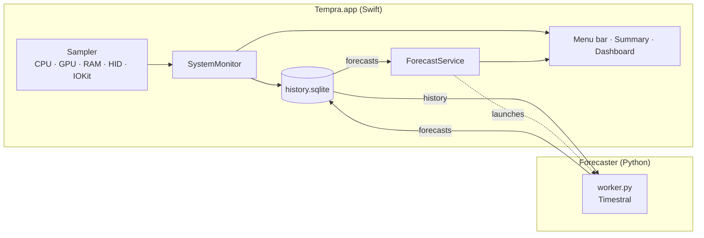

<div align="center">


# Tempra

**Your Mac's vital signs, live, over time, and a step ahead.**

A native macOS menu bar app that monitors CPU, GPU, memory, temperatures, battery and power, keeps a
long-term history, and forecasts what comes next with Mistral's **Timestral**, running entirely on your Mac.

[](#requirements)
[](#requirements)
[](https://swift.org)
[](https://developer.apple.com/xcode/swiftui/)
[](https://huggingface.co/mistralai/Timestral-5M)
[](https://pytorch.org)
[](#privacy)

[Features](#features) · [Screenshots](#screenshots) · [Install](#installation) · [Forecasting](#forecasting-with-timestral) · [Architecture](#architecture) · [Roadmap](#roadmap)

</div>

---

## Features

| | |
|---|---|
| 🧭 **Lives in the menu bar** | An icon plus one live value of your choice (CPU, GPU, memory pressure, temperature, battery or power). The icon follows the statistic you show. |
| 🪟 **Glanceable summary** | Click the icon for a compact panel with the essentials, sparklines and the latest forecasts. |
| 📊 **Full dashboard** | A real window with history from 15 minutes to 30 days, per-core CPU (P and E cores), GPU renderer and tiler load, memory breakdown, thermals, battery and power, disk and network, and a live process list. |
| 🔮 **Forecasts with Timestral** | Probabilistic forecasts (10th–90th percentile bands): time to empty or full, next-hour CPU, GPU, memory pressure, temperature and power, and a 6-month battery health projection. |
| 🗄️ **Long-term history** | Every sample for 24 h, 1-minute averages for 30 days, hourly averages forever, in a single SQLite file. |
| 🪶 **Lightweight** | Native Swift, no Electron, no daemon with root privileges. The forecaster takes about 13 ms per forecast on CPU, every 5 minutes. |
| 🎨 **Liquid Glass icon** | Designed in Icon Composer: a history line flowing into three forecast bands, in six palettes (Indigo, Night, Dawn, Aurora, Sky, Graphite) to pick from in Settings. |
| 🔒 **Private** | No accounts, no telemetry, no network calls except the one-time model download. |

### What Tempra measures

| Area | Metrics | Source |
|---|---|---|
| **CPU** | Total, user and system load, per-core load (P/E), load average | `host_processor_info` |
| **GPU** | Utilization, renderer, tiler, unified memory in use | `IOAccelerator` performance statistics |
| **Memory** | Pressure, used, app, wired, compressed, cached, swap | `host_statistics64`, `sysctl` |
| **Thermals** | SoC average and hotspot, battery, SSD, thermal state | Apple Silicon HID temperature sensors |
| **Battery** | Level, charging state, time remaining, cycles, health, capacities, voltage, current | `IOPowerSources`, `AppleSmartBattery` |
| **Power** | Whole-system power draw, battery in/out watts, adapter | `AppleSmartBattery` telemetry |
| **I/O** | Network down/up, disk read/write, free space | `getifaddrs`, `IOBlockStorageDriver` |
| **Processes** | CPU and resident memory per process | `ps` |

## Screenshots

<table>
  <tr>
    <td width="32%" valign="top"><br><sub><b>Menu bar panel</b>: the essentials at a glance</sub></td>
    <td valign="top"><br><sub><b>Dashboard overview</b>: all vitals with history</sub></td>
  </tr>
</table>

<table>
  <tr>
    <td width="50%"><br><sub><b>CPU</b>: history and per-core load</sub></td>
    <td width="50%"><br><sub><b>GPU</b>: utilization, renderer and tiler</sub></td>
  </tr>
  <tr>
    <td width="50%"><br><sub><b>Battery & power</b>: health, watts, time remaining</sub></td>
    <td width="50%"><br><sub><b>Memory</b>: pressure, breakdown and swap</sub></td>
  </tr>
</table>

## Requirements

- A Mac with **Apple Silicon** (M1 or later) running **macOS 14 Sonoma** or later
- **Xcode 16+** and **[XcodeGen](https://github.com/yonaskolb/XcodeGen)** to build
- **[uv](https://github.com/astral-sh/uv)** for the optional forecasting engine (`brew install uv`)

## Installation

```bash
git clone https://github.com/frankydedo/Tempra.git && cd Tempra
scripts/build.sh --install     # builds Release, copies to /Applications and launches
```

Then open **Settings → General** to choose what appears in the menu bar and turn on **Open Tempra at login**.

To work on the code in Xcode:

```bash
xcodegen generate && open Tempra.xcodeproj
```

## Forecasting with Timestral

[Timestral](https://huggingface.co/mistralai/Timestral-5M) is Mistral's family of zero-shot time-series
foundation models. Tempra runs it locally in a small Python worker. It needs no training on your data:
it reads your recent history and predicts the next steps, with uncertainty bands.

**Enable it** from **Settings → Forecasting → Install**, or from Terminal:

```bash
forecaster/setup.sh ~/Library/Application\ Support/Tempra/forecaster
```

This creates a private virtual environment with PyTorch and Timestral, on a native arm64 Python even when
`uv` itself runs under Rosetta. The model weights (21 MB for the 5M model) download on first run.

| Forecast | Resolution | Context | Horizon | Shown as |
|---|---|---|---|---|
| Battery level | 5 min | 7 days | 12 h | "Empty in ~2h 10m (1h 50m–2h 40m)" or time to full |
| CPU, GPU, memory pressure | 1 min | 3 days | 1 h | Average and peak for the next hour |
| SoC temperature, system power | 1 min | 3 days | 1 h | Forecast band on the history charts |
| Battery health | 1 day | all | 180 days | Projected capacity in 6 months, days until 80% |

Forecasts appear after about an hour of history (two hours for battery, two weeks of daily samples for
battery health) and refresh every 5 minutes. You can switch between **Timestral 5M** and **28M** in Settings.

## Architecture



```
Tempra/
├── App/            App entry point, menu bar label, settings keys
├── Metrics/        Readers for CPU, GPU, memory, thermals, battery, I/O, processes
├── Storage/        SQLite history (raw → minute → hour) and metric definitions
├── Forecast/       Launches the Python worker and reads its forecasts
├── Resources/      AppIcon.icon (Icon Composer) and alternate icon renders
└── UI/             Summary panel, dashboard sections, charts, settings
forecaster/         Timestral worker, pyproject and setup script
design/             Icon generator, Icon Composer documents and previews
scripts/build.sh    Release build and install
```

## Privacy

Everything stays on your Mac, in `~/Library/Application Support/Tempra/`. Tempra makes no network requests.
The forecaster downloads the model from Hugging Face once and then runs offline. You can delete all
history from **Settings → Data**.

## Roadmap

**Metrics**
- [ ] Per-component power (CPU, GPU, Neural Engine, DRAM) through a privileged helper and IOReport
- [ ] CPU cluster and GPU frequencies, GPU temperature
- [ ] Fan speed on Macs with fans (SMC)
- [ ] Per-app energy impact history
- [ ] Intel Mac support (SMC thermals)

**Forecasting**
- [ ] Covariate-aware forecasts: CPU and GPU load as past covariates for battery and temperature, time-of-day and weekday as known covariates
- [ ] Learn charging habits and suggest when to unplug to preserve battery health
- [ ] Run Timestral natively through Core ML on the Neural Engine, removing the Python dependency
- [ ] Forecast accuracy report comparing past forecasts with what actually happened

**App**
- [ ] Desktop and Notification Center widgets (WidgetKit)
- [ ] Export history to CSV and JSON
- [ ] Customisable dashboard layout and summary tiles
- [ ] Italian localization
- [ ] Signed and notarized releases, auto-updates (Sparkle) and a Homebrew cask
- [ ] Unit tests and GitHub Actions CI

## Known limitations

- Temperatures come from private IOKit HID APIs. They work on current Apple Silicon Macs, but a macOS
  update could change sensor names. For the same reason Tempra is not sandboxed and cannot ship on the App Store.
- GPU temperature is not exposed separately on Apple Silicon, so it is included in the SoC readings.
- `ps` reports process CPU as a percentage of one core, like Activity Monitor.

## Development notes

The app icons are Icon Composer documents generated from code, so every variant shares the same geometry:

```bash
python3 design/make_icons.py   # writes design/icons/*.icon and Tempra/Resources/AppIcon.icon (default)
design/export_icons.sh         # renders them with ictool for the Settings picker and docs/icon.png
swift design/contact_sheet.swift design/icon-variants.png   # side-by-side preview
```

Open any `.icon` in Icon Composer (bundled with Xcode) to fine-tune its Liquid Glass settings.

Debug builds can render every view to PNG without screen-recording permission, which is how the screenshots
above were produced:

```bash
build/DerivedData/Build/Products/Debug/Tempra.app/Contents/MacOS/Tempra -TempraSnapshotDir docs/screenshots
```

## Acknowledgements

- [Mistral AI](https://mistral.ai) for [Timestral](https://github.com/mistralai/timestral)
- [Stats](https://github.com/exelban/stats) and [asitop](https://github.com/tlkh/asitop), which document much of Apple Silicon's sensor landscape
