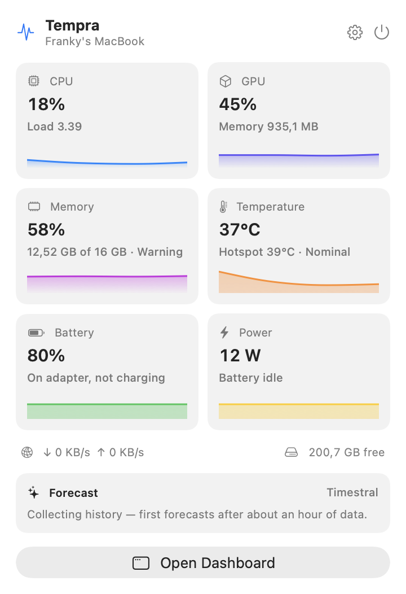
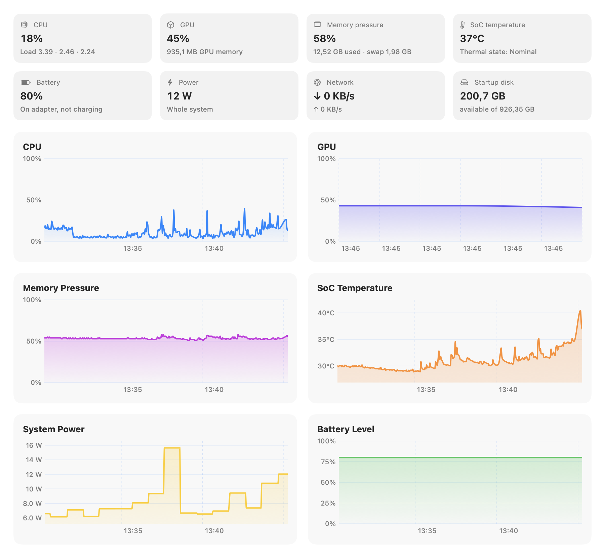
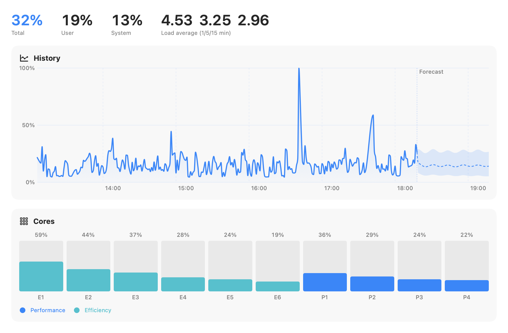
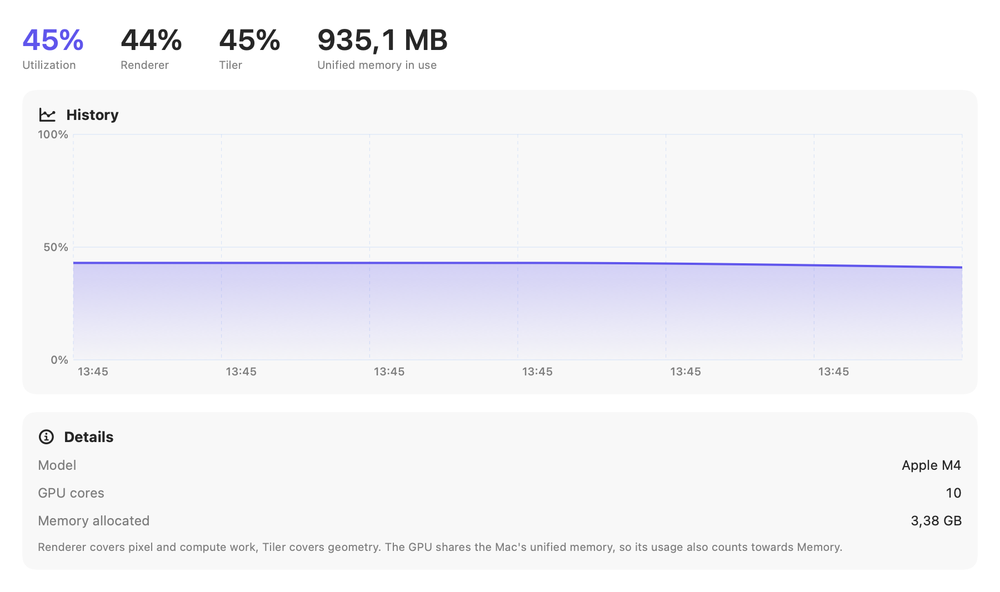
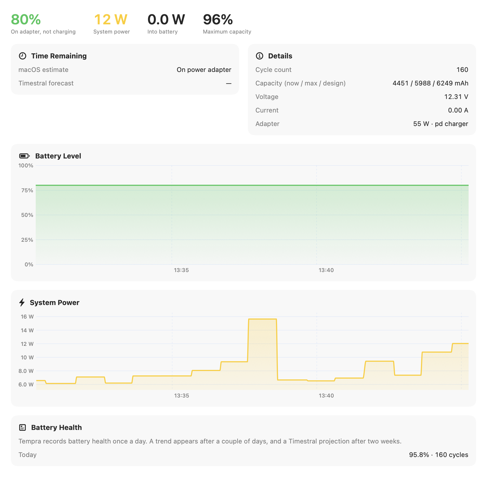
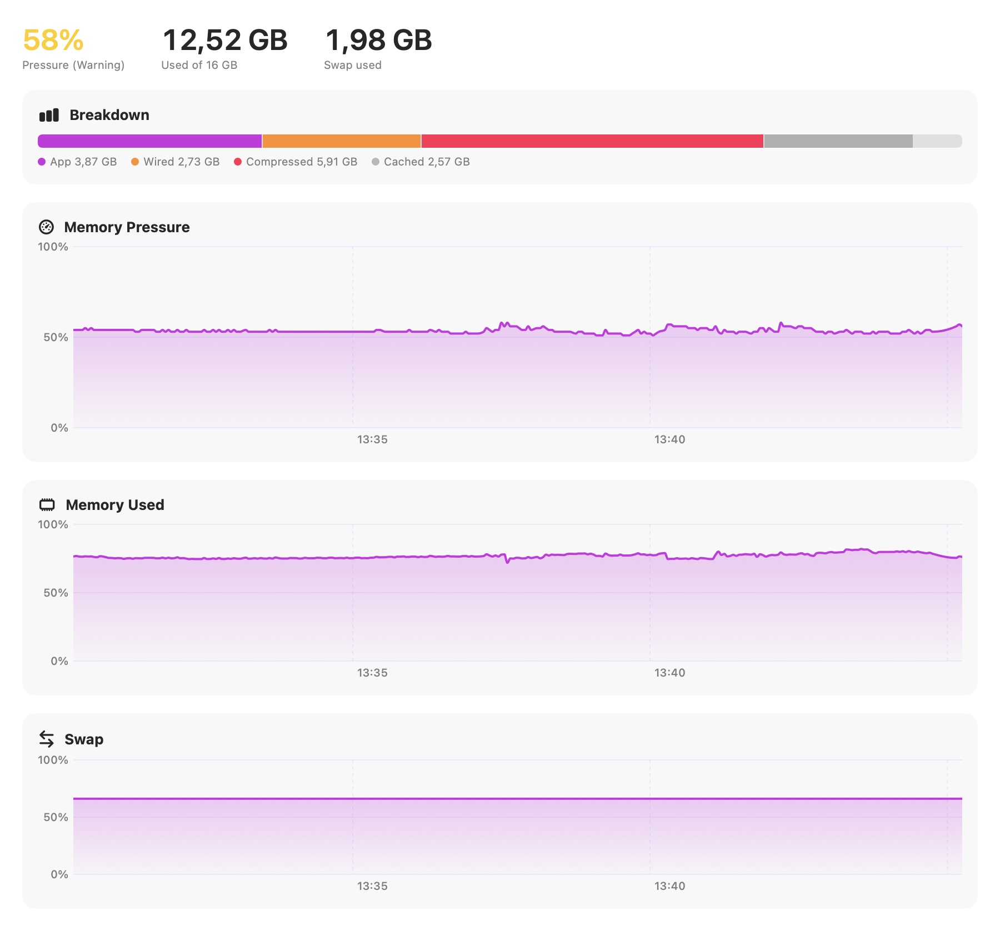
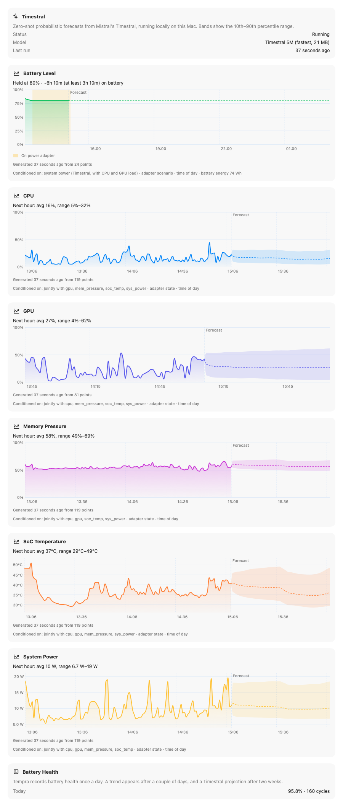
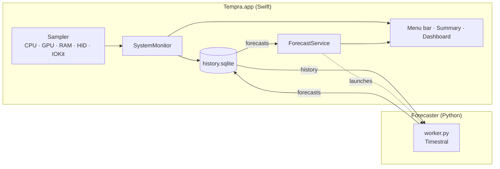

<div align="center">


# Tempra

**Your Mac's vital signs, live, over time, and a step ahead.**

A native macOS menu bar app that monitors CPU, GPU, memory, temperatures, battery and power, keeps a
long-term history, and forecasts what comes next with Mistral's **Timestral**, running entirely on your Mac.

[](#requirements)
[](#requirements)
[](https://swift.org)
[](https://developer.apple.com/xcode/swiftui/)
[](https://huggingface.co/mistralai/Timestral-5M)
[](https://pytorch.org)
[](#privacy)
[](https://github.com/frankydedo/Tempra/releases/latest)
[](LICENSE)

[Features](#features) · [Screenshots](#screenshots) · [Install](#installation) · [Forecasting](#forecasting-with-timestral) · [Architecture](#architecture) · [Roadmap](#roadmap)

</div>

---

## Features

| | |
|---|---|
| 🧭 **Lives in the menu bar** | An icon plus one live value of your choice (CPU, GPU, memory pressure, temperature, fan speed, battery or power). The icon follows the statistic you show. |
| 🚦 **Health at a glance** | Every key metric is Normal, Warning or Critical, using macOS's own signals where they exist. Warning values turn orange, Critical red, in the panel, the dashboard and the menu bar. |
| 🪟 **Glanceable summary** | Click the icon for a compact panel with the essentials, sparklines and the latest forecasts. |
| 📊 **Full dashboard** | A real window with history from 15 minutes to 30 days, per-core CPU (P and E cores), GPU renderer and tiler load, memory breakdown, thermals, battery and power, disk and network, and a live process list. |
| 🔮 **Forecasts with Timestral** | Multivariate, probabilistic forecasts (10th–90th percentile bands): time to empty or full and battery life if you unplug, next-hour CPU, GPU, memory pressure, temperature and power, and a 3-year battery health projection whose range narrows as history grows. |
| 🗄️ **Long-term history** | Every sample for 24 h, 1-minute averages for 30 days, hourly averages forever, in a single SQLite file. |
| 🪶 **Lightweight** | Native Swift, no daemon with root privileges. Charts only redraw while on screen, so Tempra uses about 1–2% of one core in the background; the forecaster a few milliseconds per minute. |
| 🎨 **Liquid Glass icon** | Designed in Icon Composer: a history line flowing into three forecast bands, in six palettes (Indigo, Night, Dawn, Aurora, Sky, Graphite) to pick from in Settings. |
| 🔒 **Private** | No accounts, no telemetry, no network calls except the one-time model download. |

### What Tempra measures

| Area | Metrics | Source |
|---|---|---|
| **CPU** | Total, user and system load, per-core load (P/E), load average | `host_processor_info` |
| **GPU** | Utilization, renderer, tiler, unified memory in use | `IOAccelerator` performance statistics |
| **Memory** | Pressure, used, app, wired, compressed, cached, swap | `host_statistics64`, `sysctl` |
| **Thermals** | SoC average and hotspot, battery, SSD, thermal state | Apple Silicon HID temperature sensors |
| **Fans** | Speed of each fan, with its minimum and maximum | System Management Controller (SMC) |
| **Battery** | Level, charging state, time remaining, cycles, health, capacities, voltage, current | `IOPowerSources`, `AppleSmartBattery` |
| **Power** | Whole Mac, chip (SoC), CPU & rest of chip, GPU, adapter input — live, every sample | SMC (`PSTR`, `PHPC`, `PDTR`), IOReport GPU energy |
| **Battery flow** | Watts into or out of the battery, adapter rating | `AppleSmartBattery` |
| **I/O** | Network down/up, disk read/write, free space | `getifaddrs`, `IOBlockStorageDriver` |
| **Processes** | CPU over the last second and memory footprint per process, as in Activity Monitor | `top` |

### Health states

| Metric | Source | Warning | Critical |
|---|---|---|---|
| Memory | Available memory (the pressure Activity Monitor plots) and swap activity | Pressure above 70% or swapping out over 1 MB/s, for a minute | Pressure above 85%, swapping over 20 MB/s, or macOS critical |
| Temperature | macOS thermal state | Serious (throttling) | Critical |
| Battery level | macOS low-battery warning | Early (below ~22%) | Final (~10 min left) |
| Battery health | macOS battery condition, Apple's 80% threshold | Capacity below 80% | Service recommended |
| CPU, GPU | 1-minute average load | 75–90% | above 90% |
| Power | Runtime at current draw, or adapter headroom | Under 2 h left, or above 90% of the adapter's rating | Under 1 h left, or battery draining while plugged in with the adapter delivering power (not when macOS uses the battery on purpose) |
| Startup disk | Free space | Under 20 GB or 10% | Under 5 GB or 3% |

Normal is left uncoloured so that Warning and Critical stand out; the state is always written out too.
Whatever the menu bar shows, a red dot on its icon flags any other metric in Critical — for example memory
while the menu bar shows CPU.
A state that gets worse shows at once; one that improves waits two minutes, so a metric hovering around a
threshold doesn't make the colours flicker.

## Screenshots

<table>
  <tr>
    <td width="32%" valign="top"><br><sub><b>Menu bar panel</b>: the essentials at a glance</sub></td>
    <td valign="top"><br><sub><b>Dashboard overview</b>: all vitals with history</sub></td>
  </tr>
</table>

<table>
  <tr>
    <td width="50%"><br><sub><b>CPU</b>: history and per-core load</sub></td>
    <td width="50%"><br><sub><b>GPU</b>: utilization, renderer and tiler</sub></td>
  </tr>
  <tr>
    <td width="50%"><br><sub><b>Battery & power</b>: health, watts, time remaining</sub></td>
    <td width="50%"><br><sub><b>Memory</b>: pressure, breakdown and swap</sub></td>
  </tr>
</table>

<p align="center">
  <br>
  <sub><b>Forecasts</b>: every Timestral forecast with its uncertainty band and what it was conditioned on</sub>
</p>

## Requirements

- A Mac with **Apple Silicon** (M1 or later) running **macOS 14 Sonoma** or later
- **[uv](https://github.com/astral-sh/uv)** for the optional forecasting engine (`brew install uv`)
- To build from source: **Xcode 26+** (for Icon Composer icons) and **[XcodeGen](https://github.com/yonaskolb/XcodeGen)**

## Installation

### Download

1. Download `Tempra-x.y.z.zip` from the [latest release](https://github.com/frankydedo/Tempra/releases/latest) and unzip it.
2. Move **Tempra.app** to **/Applications**.
3. Open it. Tempra isn't notarized by Apple yet, so the first time macOS will refuse to open it:
   go to **System Settings → Privacy & Security**, scroll down and click **Open Anyway**.
   Alternatively, from Terminal:

   ```bash
   xattr -dr com.apple.quarantine /Applications/Tempra.app
   ```

### Build from source

```bash
git clone https://github.com/frankydedo/Tempra.git && cd Tempra
scripts/build.sh --install     # builds Release, copies to /Applications and launches
```

`scripts/package.sh` produces the release zip and its SHA-256 checksum in `build/`.

### First run

Open **Settings → General** to choose what appears in the menu bar and turn on **Open Tempra at login**.

To work on the code in Xcode:

```bash
xcodegen generate && open Tempra.xcodeproj
```

## Forecasting with Timestral

[Timestral](https://huggingface.co/mistralai/Timestral-5M) is Mistral's family of zero-shot time-series
foundation models. Tempra runs it locally in a small Python worker. It needs no training on your data:
it reads your recent history and predicts the next steps, with uncertainty bands.

**Enable it** from **Settings → Forecasting → Install**, or from Terminal:

```bash
forecaster/setup.sh ~/Library/Application\ Support/Tempra/forecaster
```

This creates a private virtual environment with PyTorch and Timestral, on a native arm64 Python even when
`uv` itself runs under Rosetta. The model weights (21 MB for the 5M model) download on first run.

### How the forecasts work

Your Mac's vitals are tightly linked: load drives power and temperature, power and the adapter drive the
battery. Tempra's forecasts use those links instead of predicting each metric on its own.

| Block | Steps · context · horizon | Targets | Conditioned on |
|---|---|---|---|
| **System** | 1 min · 14 days · 1 h | CPU, GPU, memory pressure, SoC temperature, fan speed and system power, **forecast jointly** as variates of one series | Adapter state (past covariate), time of day (known-future covariate) |
| **Battery** | 5 min · 30 days · 12 h | System power, forecast jointly with CPU and GPU load | Power-source scenario and time of day (known-future covariates) |
| **Battery health** | 1 week · all · 3 years | Maximum capacity | Capacity lost per charge cycle and cycles per day (see below) |

**Battery level** comes from a hybrid model: Timestral forecasts the power the Mac will draw, and Tempra
converts it into battery percentage using the battery's actual energy (mAh × V). This stays physically
consistent from day one, even before your history contains enough discharges for a purely statistical model.
Depending on the state, Tempra shows:

| State | Shown as |
|---|---|
| On battery | "Battery until ~18:40 (17:50–19:30)" |
| Charging | "Full at ~11:25 (11:15–11:40)", plus until when it would last if you unplugged now |
| On adapter, not charging (e.g. held at the charge limit) | "Held at 80% · on battery until ~22:30" |

**While charging**, the battery level follows the same idea: the power going into the battery is the
smaller of what the battery accepts at its current level (constant current up to ~80%, then tapering) and what
the adapter has left after the system's own consumption, which Timestral forecasts. The acceptance curve is
learned from your own charging sessions, battery level by battery level; until there is enough history, a
standard Li-ion taper scaled to the current charging power is used (calibrated to macOS's own estimate right
after plugging in, when the battery gauge hasn't updated yet). The adapter's rating is read from the charger
itself (USB-C Power Delivery or MagSafe).

The battery chart shades charging periods in green and time on the adapter without charging (for example
held at 80% by optimized charging) in yellow.

### Battery health over three years

Battery wear is slow (a few tenths of a percent a month) and long-term, so instead of a time-series model
Tempra projects it from two rates:

> capacity in *t* days = capacity now − capacity lost per cycle × cycles per day × *t*

Both start as wide estimates — capacity lost per cycle from the battery's lifetime average (capacity lost so
far ÷ cycles so far), cycles per day from a vague prior — and are refined with this Mac's own history (the
trend of capacity against cycle count, and the cycles actually used each day). The 10–90% range comes from
sampling both rates, so it is **wide on day one and narrows as days and cycles accumulate**: in a simulation,
from about 34 points of range after two days to 5 after six months and under 4 after a year. Tempra shows the
expected capacity in three years and when it should reach 80%, the level below which Apple recommends service.

### Do forecasts get better over time?

Yes, up to a point. Timestral is zero-shot: its weights never change and it is not trained on your data.
What grows is the history it reads. With two weeks of context for the system block it can see daily and
weekly habits; with 30 days of battery history, your real discharge patterns. Beyond those windows older
data is not used, so forecasts keep adapting to how you use your Mac now.

### Accuracy

Tempra checks its own forecasts. It keeps a copy of each forecast every 15 minutes and, once the horizon has
passed, compares it with what actually happened. **Forecasts → Accuracy** shows, for the last 7 days:

- **Typical error**: mean absolute difference between forecast and reality, in the metric's unit.
- **vs. "no change"**: how much better (or worse) Timestral did than simply assuming the current value stays put.
- **Inside band**: how often reality fell inside the 10–90% band. A well-calibrated forecast is close to 80%.

Bands calibrate themselves: every scored forecast widens or narrows its metric's band a little, so that over
time about 80% of what actually happens falls inside it.

Battery forecasts are scored only while the adapter state stays the same as when they were made, and the
"held at the charge limit" state is not scored, since it isn't a real prediction.

Forecasts appear after about an hour of history (two hours for battery; the battery health projection from
the first day) and refresh every minute. On an M4 a full refresh takes under a second of CPU time. You can switch between **Timestral 5M** and **28M** in Settings.

## Architecture



```
Tempra/
├── App/            App entry point, menu bar label, settings keys
├── Metrics/        Readers for CPU, GPU, memory, thermals, battery, I/O, processes
├── Storage/        SQLite history (raw → minute → hour) and metric definitions
├── Forecast/       Launches the Python worker and reads its forecasts
├── Resources/      AppIcon.icon (Icon Composer) and alternate icon renders
└── UI/             Summary panel, dashboard sections, charts, settings
forecaster/         Timestral worker, pyproject and setup script
design/             Icon generator, Icon Composer documents and previews
scripts/build.sh    Release build and install
```

## Privacy

Everything stays on your Mac, in `~/Library/Application Support/Tempra/`. Tempra makes no network requests.
The forecaster downloads the model from Hugging Face once and then runs offline. You can delete all
history from **Settings → Data**.

## Roadmap

**Metrics**
- [x] Live power by component without privileges: whole Mac, chip, CPU & rest of chip, GPU
- [ ] Neural Engine and memory power (macOS only exposes them to privileged processes)
- [ ] CPU cluster and GPU frequencies, GPU temperature
- [ ] **Who's consuming**: the processes behind CPU, GPU and power spikes, recorded during the spike and annotated on the charts, plus an energy ranking per app
- [ ] Intel Mac support (SMC thermals)

**Forecasting**
- [x] Multivariate forecasts with covariates (adapter state, time of day) and a physics-based battery model
- [x] **Clock-time forecasts**: "battery until ~18:40", "full at ~11:25", and "will it last until 19:00?" answered with a chance from the forecast bands
- [ ] **Battery report**: daily and weekly time on battery, real runtime per full charge, charging habits (e.g. hours spent at 100%) with battery-health tips
- [ ] Startup disk forecast: when the disk will be full at the current rate
- [ ] Run Timestral natively through Core ML on the Neural Engine, removing the Python dependency
- [x] Forecast accuracy report comparing past forecasts with what actually happened

**App**
- [ ] Desktop and Notification Center widgets (WidgetKit): CPU, memory, battery with its forecast, temperature
- [ ] Export history to CSV and JSON
- [ ] Customisable dashboard layout and summary tiles
- [ ] Italian localization
- [ ] Signed and notarized releases, auto-updates (Sparkle) and a Homebrew cask
- [ ] Unit tests and GitHub Actions CI

## Known limitations

- Temperatures come from private IOKit HID APIs. They work on current Apple Silicon Macs, but a macOS
  update could change sensor names. For the same reason Tempra is not sandboxed and cannot ship on the App Store.
- GPU temperature is not exposed separately on Apple Silicon, so it is included in the SoC readings.
- Process CPU is a percentage of one core and memory is the physical footprint, as in Activity Monitor.

## Development notes

Tempra logs state changes (adapter plugged or unplugged, health state transitions with the values behind
them, forecaster lifecycle, battery forecast changes) to `~/Library/Logs/Tempra/Tempra.log` and to the macOS
unified log. The forecaster writes to `~/Library/Logs/Tempra/forecaster.log`.

```bash
tail -f ~/Library/Logs/Tempra/Tempra.log
/usr/bin/log stream --predicate 'subsystem == "com.fdedominicis.tempra"'
```

The app icons are Icon Composer documents generated from code, so every variant shares the same geometry:

```bash
python3 design/make_icons.py   # writes design/icons/*.icon and Tempra/Resources/AppIcon.icon (default)
design/export_icons.sh         # renders them with ictool for the Settings picker and docs/icon.png
swift design/contact_sheet.swift design/icon-variants.png   # side-by-side preview
```

Open any `.icon` in Icon Composer (bundled with Xcode) to fine-tune its Liquid Glass settings.

Debug builds can render every view to PNG without screen-recording permission, which is how the screenshots
above were produced:

```bash
build/DerivedData.noindex/Build/Products/Debug/Tempra.app/Contents/MacOS/Tempra -TempraSnapshotDir docs/screenshots
```

## License

Tempra is released under the [MIT License](LICENSE).

Timestral's code is Apache 2.0 and its model weights are under Mistral's Modified MIT license. Neither is
included in this repository: the forecasting engine downloads them when you install it.

## Acknowledgements

- [Mistral AI](https://mistral.ai) for [Timestral](https://github.com/mistralai/timestral)
- [Stats](https://github.com/exelban/stats) and [asitop](https://github.com/tlkh/asitop), which document much of Apple Silicon's sensor landscape
